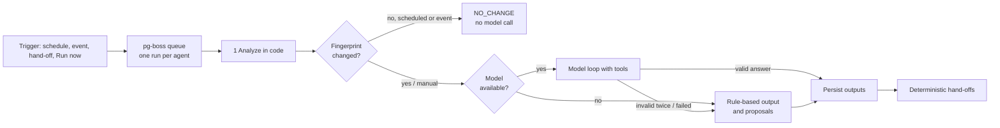

# Agents

Stockroom has eight agents. Seven work in the background on schedules and events; the Assistant works in chat.
They share one rule: **numbers come from code, judgment comes from the model.** Every figure an agent states
was computed by a tested function in `apps/server/src/analytics/` and handed to the model as facts or through a
read tool. The model decides what matters, explains it, and chooses which changes to propose.

- Code: `apps/server/src/agents/` (runtime, tools, definitions) and `apps/server/src/analytics/` (the maths).
- UI: **Agents** (hub, settings, run history and timelines), **Approvals** (proposals), **Assistant** (chat).

## How a run works

1. **Analyze (code).** Each agent's analyzer loads data through services and runs the pure analytics. Some
   informational outputs are written here because they must stay current whatever the model does (alert facts,
   forecasts, supplier scorecards, ABC–XYZ classes).
2. **No change.** Scheduled and event runs hash the analysis. If it matches the last result, the run ends as
   `NO_CHANGE` without calling a model.
3. **Model loop.** The model gets the agent's prompt, common rules, a briefing (today, policy, the analysis facts,
   and how people responded to its last ten proposals) and its tools. Each tool call is validated with Zod;
   invalid arguments go back to the model as a structured error so it can correct itself. The loop ends with a
   final JSON answer that must match the agent's schema (one repair attempt), or when a limit is reached.
4. **Grounding.** The model's summary and each finding must name something from the analysis (a product,
   warehouse, supplier or document) or quote one of its figures. If the summary doesn't, the computed summary is
   kept; ungrounded findings are dropped. The run timeline notes it. Small local models occasionally write fluent
   text about nothing in particular; this keeps the line people read first factual.
5. **Fallback.** With no model, or an answer that fails validation twice, the run uses the analyzer's rule-based
   summary, findings and proposals, labelled **Rule-based — AI unavailable**. If the model finished but proposed
   nothing, the computed proposals are still created (people approve them anyway).
6. **Hand-offs** are fixed rules in code (the Stock Sentinel hands urgent items to the Replenishment Planner).
   Models never decide which agent runs next.

Every run is recorded: trigger, model and provider actually used, timings, tokens, and every step (analysis,
briefing, model calls with reasoning, tool calls with arguments and results, validation errors, hand-offs). The
run page streams these live over server-sent events.

### Native tools or the JSON protocol

Models that support tool calling get native tool schemas (generated from Zod with `z.toJSONSchema` and adjusted
per provider). Models without it, or that refuse tools, get the same tools described in the prompt and answer with
`{"tool_calls": [...]}` or `{"final": {...}}`. The protocol is chosen per model, so a fallback chain can mix both.

### Autonomy and proposals

Write tools never change data. They create **proposals** through `ActionService`, which validates the payload,
computes the impact and risk in code, and applies the agent's autonomy:

| Autonomy            | What happens to a proposal                                                                 |
| ------------------- | ------------------------------------------------------------------------------------------ |
| Observe             | Recorded as a finding on the run; nothing is queued.                                       |
| Recommend (default) | Waits in **Approvals** for a person to approve, edit and approve, or reject with a reason. |
| Act                 | Low-risk proposals within the limits execute immediately; the rest wait for approval.      |

- **Risk** is computed, not judged: e.g. a purchase order is high risk above twice the approval threshold or when a
  line covers more than 180 days of demand, medium at or above the threshold, off-catalog prices or lines.
- **Dedupe:** one open proposal per key (a PO per supplier and warehouse, a transfer per route, one per product for
  settings); a product can't sit in two open PO proposals for one warehouse; a rejected proposal isn't repeated for
  72 hours; pending proposals expire after 7 days.
- **Approval executes** the change through the normal services (as the agent on behalf of the approver), so stock,
  audit log and events behave exactly as if a person did it.
- **Feedback:** approvals, edits (what changed) and rejection reasons are included in the agent's next briefing.

### Limits (editable per agent)

Model calls per run, tool calls per run, time limit, proposals per run, and the Act-mode purchase-order value
limit. One run per agent at a time; a run left running by a restart is marked failed at boot.

### Tools

| Read tools                                                                          |                                                                                                          |
| ----------------------------------------------------------------------------------- | -------------------------------------------------------------------------------------------------------- |
| `get_inventory_kpis`                                                                | Inventory value, revenue, fill rate, stockouts, alerts, open POs, approvals, turnover, most at risk      |
| `list_stock_positions`                                                              | Stock by product × warehouse with state, on order and days of cover; filter by warehouse, state, product |
| `search_products`, `get_product_details`                                            | Find products; one product's prices, policy, stock per warehouse, sales, suppliers                       |
| `get_sales_history`, `query_sales_summary`                                          | Weekly sales for a product; units, revenue and margin by category, warehouse or product                  |
| `get_forecast`                                                                      | Latest forecast with method, accuracy and the next four weeks with 80 % bands                            |
| `list_open_alerts`, `list_open_purchase_orders`, `list_pending_actions`             | What is open right now                                                                                   |
| `compare_suppliers`, `get_supplier_scorecards`, `get_supplier_scorecard`            | Supplier options for a product; scores and metrics                                                       |
| `compute_reorder_plan`                                                              | The planner's computed orders (quantities, suppliers, cover before and after)                            |
| `get_abc_xyz_summary`, `list_slow_and_dead_stock`, `find_rebalancing_opportunities` | The optimizer's views                                                                                    |
| `get_agent_activity`                                                                | Runs and proposals per agent over N days                                                                 |

| Write tools (→ proposals, or confirmation cards in chat) |                                                                                     |
| -------------------------------------------------------- | ----------------------------------------------------------------------------------- |
| `propose_purchase_order`                                 | One PO to one supplier for one warehouse; quantities must respect MOQ and pack size |
| `propose_transfer`                                       | Move stock between warehouses (checked against what is available at the source)     |
| `propose_reorder_params`                                 | New reorder point, safety stock and max stock for a product at a warehouse          |
| `propose_cycle_count`                                    | Count specific products at a warehouse                                              |
| `propose_markdown`                                       | A lower selling price, never below cost                                             |
| `propose_preferred_supplier_change`                      | Prefer another active supplier already in the catalog                               |

Tools accept ids, codes (SKU, warehouse and supplier codes) or exact names, because small models copy short codes
far more reliably than UUIDs. Results are compact (about 40 rows at most) so they fit small context windows.

---

## Stock Sentinel

**Job:** watch every product at every warehouse and keep clear, prioritized stock alerts.
**Triggers:** every 15 minutes, after stock changes and PO status changes (events collected for 60 s, then one
run), at startup.
**Tools:** KPIs, stock positions, product details, sales history, open alerts, open POs.

**Code (`analytics/stock-health.ts`):**

- _Out of stock:_ available ≤ 0 for an item that sells (critical when it sells ≥ 1/day or its PO is overdue).
- _Low:_ available + on order ≤ reorder point; high when days of cover < lead time.
- _Projected stockout:_ days of cover = available ÷ average daily demand (28 days) is below the lead time.
- _Overstock:_ above twice the max stock, or more than the overstock threshold (180 days) of cover, worth ≥ ₹5,000.
- _Expiring batches:_ within the warning window (14 days), with the share unlikely to sell before expiry.
- Priority 0–100 = severity base + value of demand at stake + urgency.

Alerts are synced every run (created, updated, auto-resolved when the condition clears). A person-resolved alert
isn't raised again within the dedupe window (24 hours).

**Model:** explains new and worsening issues for a store manager, may re-rank priority within ±10, and lists the
items to replenish now. **Hand-off:** items that are out or low with nothing on order go to the Replenishment
Planner. **Without a model:** alerts carry rule-based explanations; the same hand-off rule applies.

## Demand Forecaster

**Job:** forecast daily demand for every product four weeks ahead. **Triggers:** nightly at 02:00, Run now.
**Tools:** forecast, sales history, sales summary, product search and details.

**Code (`analytics/forecasting.ts`):**

- _Pattern_ (Syntetos–Boylan): ADI = days ÷ days with demand, CV² of non-zero demand sizes. Smooth: ADI < 1.32 and
  CV² < 0.49; erratic: ADI < 1.32, CV² ≥ 0.49; intermittent: ADI ≥ 1.32, CV² < 0.49; lumpy: both above.
- _Smooth or erratic:_ damped additive Holt-Winters with weekly seasonality (m = 7):
  ℓₜ = α(yₜ − sₜ₋ₘ) + (1 − α)(ℓₜ₋₁ + φbₜ₋₁), bₜ = β(ℓₜ − ℓₜ₋₁) + (1 − β)φbₜ₋₁, sₜ = γ(yₜ − ℓₜ) + (1 − γ)sₜ₋ₘ;
  forecast ŷₜ₊ₕ = ℓₜ + (φ + … + φʰ)bₜ + sₜ₊ₕ₋ₘ. α, β, γ, φ by grid search on one-step SSE. Simple exponential
  smoothing is fitted too, and whichever has the lower holdout WAPE is used.
- _Intermittent or lumpy:_ Croston with the Syntetos–Boylan correction, rate = (1 − α/2) · ẑ / p̂.
- _Under 56 days of history:_ 28-day moving average.
- _Accuracy:_ 28-day holdout; MAPE on days with demand, WAPE = Σ|actual − forecast| ÷ Σ actual.
- _Bands:_ ŷ ± z·σ·√h with σ the spread of one-step residuals (z = 1.2816 for 80 %, 1.96 for 95 %), floored at 0.
- _Shifts:_ average daily demand moving ≥ 30 % from the previous forecast (and ≥ 1 unit/day) raises a forecast-shift
  alert.

**Model:** a short outlook per category with shifts: what is rising or falling, how reliable the forecast is, what a
buyer should do. **Outputs:** stored forecasts (the planner prefers them over raw history), alerts, outlook.

## Replenishment Planner

**Job:** turn low stock into ready-to-approve purchase orders, one per supplier and warehouse, within the budget.
**Triggers:** Sentinel hand-off (only the named products), daily at 07:00, Run now.
**Tools:** reorder plan, supplier comparison, product details, sales history, open POs, pending proposals,
scorecards, `propose_purchase_order`.

**Code (`analytics/replenishment.ts`):**

- Demand d̄ and σd per day from the latest forecast (split across warehouses by their share of sales) or 56 days of
  history; lead time L from the chosen supplier; lead-time spread σL = 0.15·L until supplier history refines it.
- z = Φ⁻¹(service level) (Acklam's approximation); **safety stock** SS = z·√(L·σd² + d̄²·σL²).
- **Reorder point** = d̄·L + SS (the configured reorder point is used as the trigger when set).
- **EOQ** = √(2·D·S ÷ H), D = 365·d̄, S = order cost (₹500), H = unit cost × holding rate (20 %).
- **Order-up-to** = d̄·(L + R) + SS with review period R = 7 days. Inventory position = available + on order.
- Quantity = max(EOQ, order-up-to − position), capped at max stock, rounded up to whole packs and at least the MOQ.
- **Supplier choice:** 50 % lowest landed cost, 30 % shortest lead time, 20 % score, small bonus for the preferred.
- **Priority** = shortfall ÷ reorder point + urgency (runs out within the lead time) + stockout + value; lines are
  filled greedily up to the budget (₹15,00,000); urgent lines may exceed it by 10 %.
- Flags judgment calls: MOQ forcing a much larger order, max-stock caps, configured reorder points far from the
  computed ones, a faster supplier being available.

**Model:** reviews the computed orders, keeps, trims or re-sources them with reasons, and calls
`propose_purchase_order` with a rationale per line. **Without a model:** the computed orders are proposed as-is.

## Anomaly Auditor

**Job:** catch what looks wrong. **Triggers:** hourly; after stock adjustments, completed counts and receipts.
**Tools:** open alerts, product details, sales history, open POs, supplier comparison, `propose_cycle_count`.

**Code (`analytics/anomalies.ts`):**

- _Demand spikes:_ robust z = 0.6745·(x − median)/MAD > 3.5 against the previous 56 days, and at least 5× the median
  (a weekly peak clears the z-score alone).
- _Repeated losses:_ ≥ 3 negative adjustments or write-offs (other than expiry) for one item at one warehouse in
  14 days.
- _Count variances:_ more than 5 % of the expected quantity or more than ₹1,000.
- _Receipts:_ invoiced unit cost more than 5 % from the PO price; a PO closed more than 5 % short.
- _Cost jumps:_ latest unit cost more than 15 % above the 90-day median for that product and supplier.

**Model:** triages each new finding (likely cause, severity, what to check) and proposes cycle counts where the
records look wrong. **Without a model:** rule-based explanations and one cycle count per warehouse for the affected
items. Resolved anomaly alerts stay quiet for 14 days.

## Supplier Analyst

**Job:** score suppliers and flag the risky ones. **Triggers:** Mondays at 06:00; after goods are received.
**Tools:** scorecards, supplier comparison, open POs, product details, `propose_preferred_supplier_change`.

**Code (`analytics/supplier-score.ts`), over 180 days:**

- On-time rate (received by the expected date + 1 day; open POs past due count as late), lead-time mean and
  coefficient of variation, fill rate (received ÷ ordered on settled POs), price trend (last 90 days vs the 90
  before, weighted by spend), rejection rate.
- **Score** = 35 % on-time + 20 % fill + 15 % lead-time stability + 15 % price + 15 % quality, from 0 to 100;
  risk high / medium / low from the score and flags.
- Scores are saved on each run. Alerts for high-risk suppliers or a drop of 10 points or more.
- Alternatives: products whose preferred supplier is high risk or scores below 60, where another active supplier
  scores at least 10 points higher at no more than 10 % higher cost.

**Model:** explains score changes and risks with the metrics and proposes preferred-supplier changes.

## Inventory Optimizer

**Job:** free up cash and shelf space. **Triggers:** Mondays at 05:00, Run now.
**Tools:** ABC–XYZ summary, slow and dead stock, rebalancing, product details, sales history, pending proposals,
`propose_transfer`, `propose_markdown`, `propose_reorder_params`.

**Code (`analytics/optimization.ts`):**

- **ABC** by annual consumption value (cost of goods sold, 365 days): A = first 80 % of value, B = next 15 %, C = rest.
- **XYZ** by the coefficient of variation of weekly demand (52 weeks): X ≤ 0.5, Y ≤ 1.0, Z > 1.0 or no demand.
- **Dead stock:** on hand with no sale for 90 days; **slow:** more than 180 days of cover (₹2,000 minimum).
  Suggested clearance price: halfway to cost, at least 10 % off, never below cost.
- **Rebalancing:** a warehouse with cover above 2× the 30-day target and another below its lead time; move enough to
  bring the destination to target without taking the source below it.
- **Reorder-point drift:** configured reorder point more than 30 % from the computed one (A and B items).

**Model:** ranks opportunities by value and writes the transfer, markdown and reorder-setting proposals.

## Report Writer

**Job:** the morning briefing and the weekly summary. **Triggers:** daily at the briefing time (Settings →
Organization, default 08:00), Mondays at 09:00 (weekly), Run now.
**Tools:** KPIs, open alerts, pending proposals, open POs, sales summary, agent activity.

**Code:** revenue and units for the period vs the one before, inventory value, fill rate, out of stock, items to
reorder, open and overdue POs, new and resolved alerts by type, POs raised (and how many came from agents),
deliveries, the most urgent open risks, each agent's runs and proposals, and the decisions waiting.

**Model:** a concise narrative that leads with the most important thing and quotes the numbers. **Without a model:**
the same facts in plain sentences. The report is stored either way.

## Assistant

**Job:** answer questions about the inventory with real data, and draft changes for people to confirm.
**Where:** the **Assistant** page, the side panel (top bar **Ask**, or Ctrl+J), and **Ask the Assistant** in the
command palette.

- Uses the same read tools as the agents; every number in an answer comes from a tool result, and the answer says
  which data it used. Series results (weekly sales, forecasts, sales by group) are shown as charts.
- Write tools don't create proposals here: they produce a **confirmation card** with the computed impact. Nothing
  happens until the person presses **Confirm**; the change then runs **as that person**, with their permissions, and
  is recorded as an approved action and in the audit log.
- Answers stream as they are written. Each turn is recorded as an agent run (trigger `CHAT`) with the full trace.
- Conversations are private to the person who started them.
- Without a model, the Assistant says how to set one up; everything else in the app keeps working.

## Configuring agents

On each agent's **Settings** tab, managers and admins can turn it on or off, choose its autonomy, edit its schedule
(five-field cron, or `@briefing`), the events that trigger it and the debounce, pick a model for it, set its limits,
and edit its instructions (with _Restore default_). The analyzers, tools and hand-off rules are code and stay fixed.
Models and the fallback chain are set in **Settings → AI & models**.

## Triggers and startup

- **Events** are collected per agent for a fixed window from the first one (its debounce setting), then one run
  starts with every product involved. The window doesn't restart on each event, so a busy day or the simulator
  can't keep an agent waiting.
- **Startup:** the Stock Sentinel always takes a first look. The Demand Forecaster, Inventory Optimizer and Report
  Writer also run once if their outputs don't exist yet (after `pnpm db:seed` or a demo reset), instead of waiting
  for their nightly or weekly schedule.
- **Restarts:** runs interrupted by a server restart are marked as such, and their queue jobs are cleared at boot so
  the agent's queue isn't blocked.
