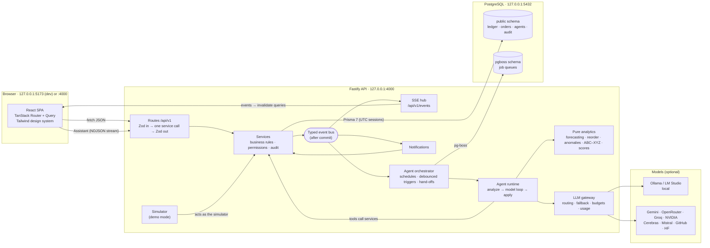
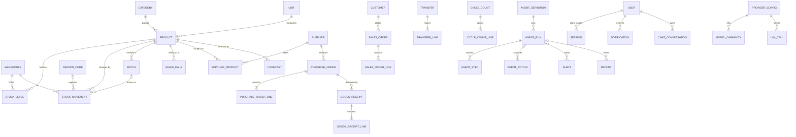
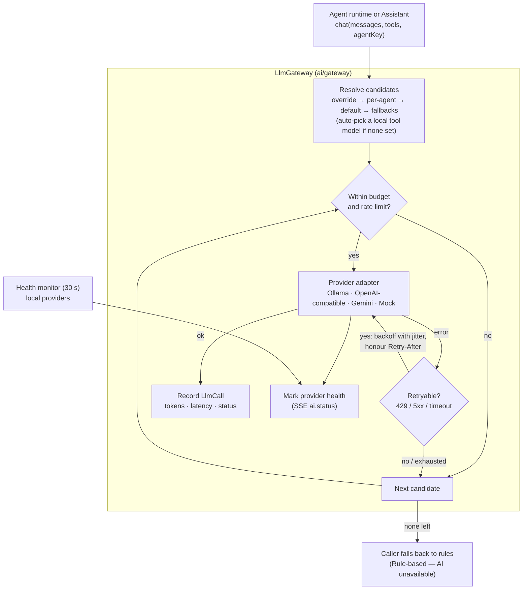
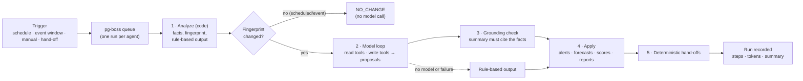
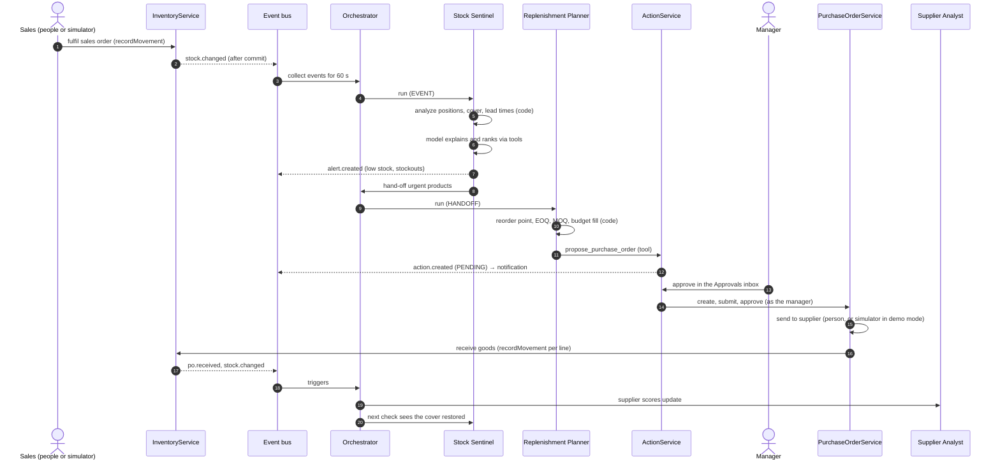

# Architecture

Stockroom is a localhost-only monorepo: a React single-page app, a Fastify API with the agent runtime and LLM
gateway inside it, PostgreSQL, and optional local or cloud models. This document shows how the parts fit; the
data model, API list and phase decisions are in [`PLAN.md`](PLAN.md), and each agent is described in
[`AGENTS.md`](AGENTS.md).

## System

The rules that hold everywhere:

- **Routes are thin.** They validate with the shared Zod schemas, call one service method and serialize the result.
  No route touches Prisma.
- **Services own the rules.** Every method receives an `Actor` (a person, an agent with its run ID, the system or
  the simulator), checks the permission, and writes an `AuditLog` row in the same transaction as the change.
- **Stock changes only through `InventoryService.recordMovement()`**: row locks, a ledger row with the balance
  after it, the balance update, the daily sales rollup and a refusal to go negative, in one transaction. A database
  CHECK is the backstop, and `pnpm check:ledger` verifies the invariants.
- **Events go out after commit** on a typed bus. The SSE hub forwards them to browsers (notifications only to
  their recipient), and the orchestrator turns them into agent runs.
- **Agents are clients of the services.** Their tools call the same methods people use; agents never touch the
  database directly, and anything consequential becomes a proposal.
- **Numbers come from code.** `apps/server/src/analytics/` is pure and unit-tested; models read its results.

## Data model (core)

All tables use UUIDv7 keys, snake_case names and `timestamptz` columns. Money is `numeric` in the database,
`decimal.js` in services and a string in JSON. `v_stock_positions` is a view joining balances, open orders and
28-day demand into each position's state (out, low, on order, OK, over). `AuditLog` records every mutation with
its actor; `LlmCall` records every model attempt with tokens, latency and outcome.

## LLM gateway

- Nothing outside `ai/gateway` imports an adapter; changing provider or model is a settings change.
- Tool calling uses native function calling when the model supports it, and a strict JSON protocol otherwise.
  Answers are validated with Zod and repaired once before falling back.
- Keys are AES-256-GCM encrypted at rest, returned to the browser only as their last four characters, and redacted
  from logs.

## Agent run

## Sentinel → Planner → approval → purchase order → receipt

## Front end

- **Routing and data:** TanStack Router (file routes, code-split per page) and TanStack Query with keys from
  `lib/query-keys.ts`. One `EventSource` feeds a single map from server event to the queries it makes stale, plus
  live stores for agent step labels, the simulator and notification pop-ups.
- **Design system:** tokens in `styles/globals.css` (light and dark), Radix primitives restyled, Lucide icons,
  tabular numerals for figures, and every data view with skeleton, empty and error states. `pnpm qa:screens`
  captures every page at three widths in both themes; `pnpm test:e2e` runs smoke and axe accessibility checks.
- **Forms:** react-hook-form with the shared Zod schemas, so the browser and the server validate the same way.

## Operations

- Everything binds to `127.0.0.1`; the UI loads nothing from the internet (fonts and icons are bundled). The only
  outbound calls go to cloud model providers you enable.
- Database sessions run in UTC. Day-based figures use the organization's time zone and complete days.
- `DEMO_MODE=true` enables the simulator and the one-click reset, which reloads the seed (about 47 s) while
  keeping AI and agent settings, sessions and preferences.
